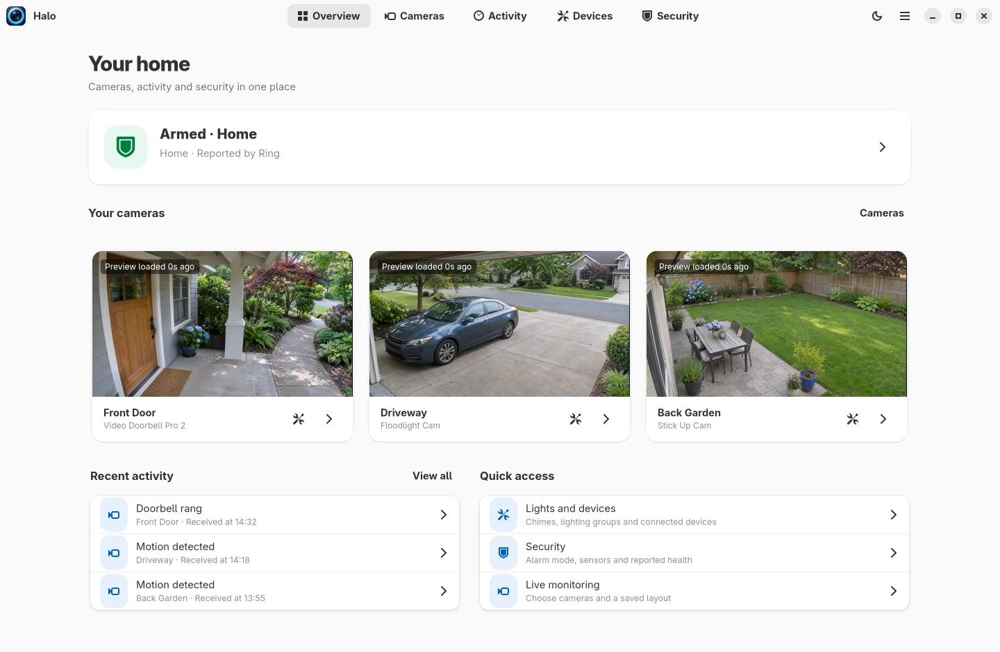
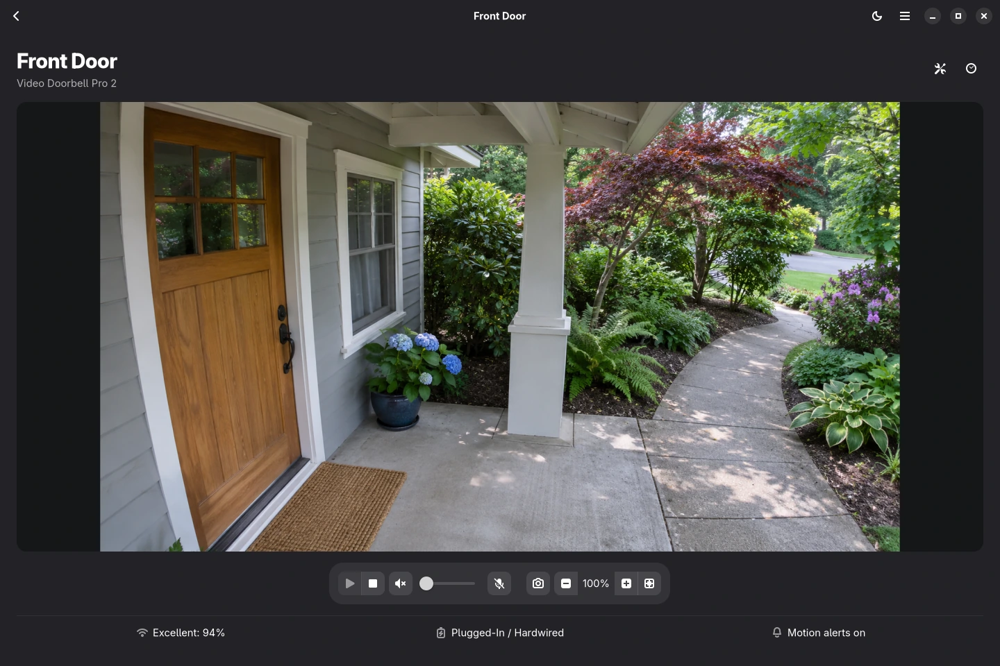
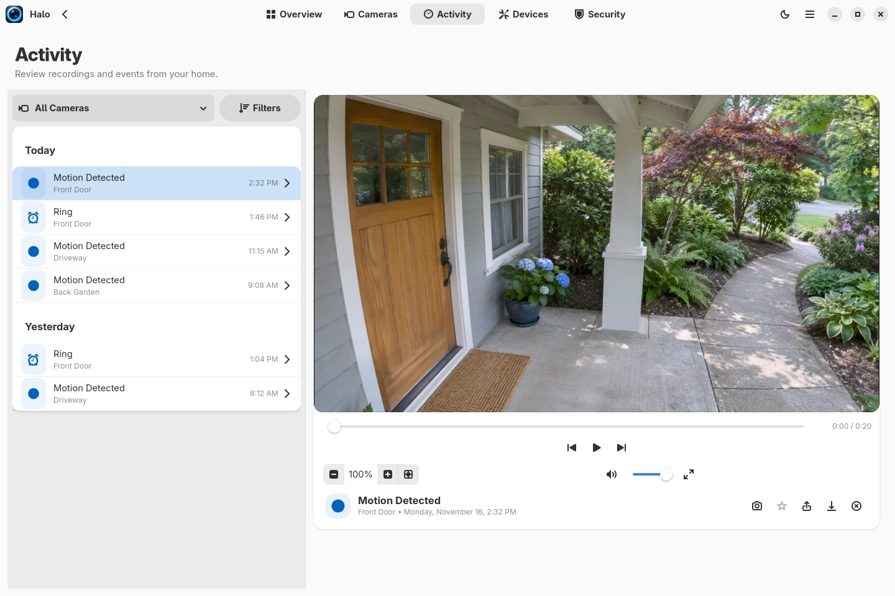
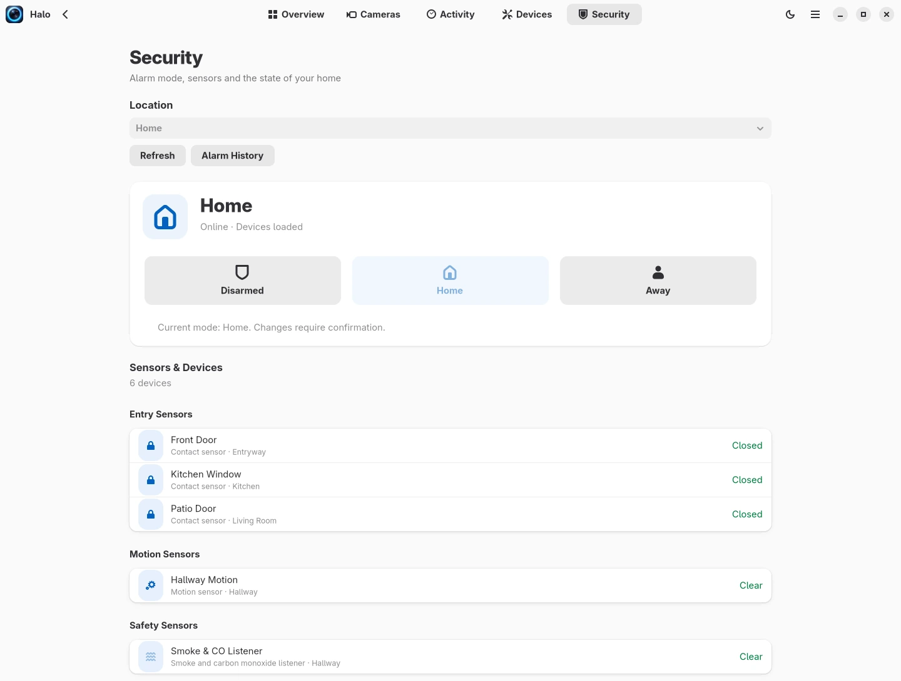

  

<h1 align="center">Halo</h1>

  <strong>Your home. In view.</strong> 
  Your Ring cameras, activity, and everyday controls. 
  Beautifully at home on Linux.

  <a href="doc/guide.md#installation"><strong>Get Halo →</strong></a>
  &nbsp; · &nbsp;
  <a href="#a-clearer-view-of-home">Take a look</a>
  &nbsp; · &nbsp;
  <a href="doc/guide.md">Explore the guide</a>

<picture>
  <source media="(prefers-color-scheme: dark)" srcset="doc/images/showcase/overview-dark.webp">
  <source media="(prefers-color-scheme: light)" srcset="doc/images/showcase/overview-light.webp">
  
</picture>

The Halo app, shown with fictional imagery and simulated device activity.

 

## A clearer view of home

The front door. The driveway. The garden beyond the kitchen window.
Halo brings the places you care about into a calm, considered desktop app.
Camera previews, recent activity, and your reported security state come together
in one welcoming overview.

### Watch the whole picture. Or take a closer look.

Keep several cameras in view with saved monitoring layouts. Open one camera
for a generous, distraction-free view, listen in, or speak through compatible
cameras. Zoom into the details and save a snapshot when a moment matters.

 

### Find the moment. Keep what matters.

A doorbell ring, a delivery, a little movement in the garden. Browse activity
by camera and event, revisit available recordings, and move through the day
without losing your place. Keep useful moments in Favorites, download a clip,
or share it with someone who needs to see it.

 

### More of your home, together.

Check your Ring Alarm, see reported door and motion-sensor states, and keep
supported lights, keypads, and Chimes within reach. Cameras and everyday
controls feel like parts of the same home.

 

## Fits your desktop. Follows your rhythm.

- **Light or dark. Always Halo.** Follow your desktop's appearance or choose
  your own. Spacious views adapt naturally when your window gets smaller.
- **Awareness on your terms.** Per-device notifications, quiet hours, and snooze
  help you decide when everyday activity deserves your attention.
- **Privacy within reach.** Current camera views respect Ring's privacy settings,
  with clear listening and microphone controls.
- **Free to make your own.** Open source, thoughtfully designed, and built for
  life on the Linux desktop.

 

<h2 align="center">Make room for Halo.</h2>

  Bring your Ring home to your desktop.  
  <a href="doc/guide.md#installation"><strong>Get started →</strong></a>
  &nbsp; · &nbsp;
  <a href="doc/guide.md#requirements">Find your setup</a>
  &nbsp; · &nbsp;
  <a href="doc/guide.md#device-controls-and-limits">Explore device support</a>

  Looking for Apple Home integration? 
  Meet <a href="https://github.com/JamesFromFL/halo-server"><strong>Halo Server</strong></a>, for your Apple Home.

---

  Free and open source · <a href="LICENSE">GPL-3.0-or-later</a> · <a href="doc/guide.md">Halo Guide</a> 
  Halo is an independent project, not affiliated with or endorsed by Ring or Amazon. 
  Screenshots use fictional scenes and demonstration device data, never private camera feeds.

